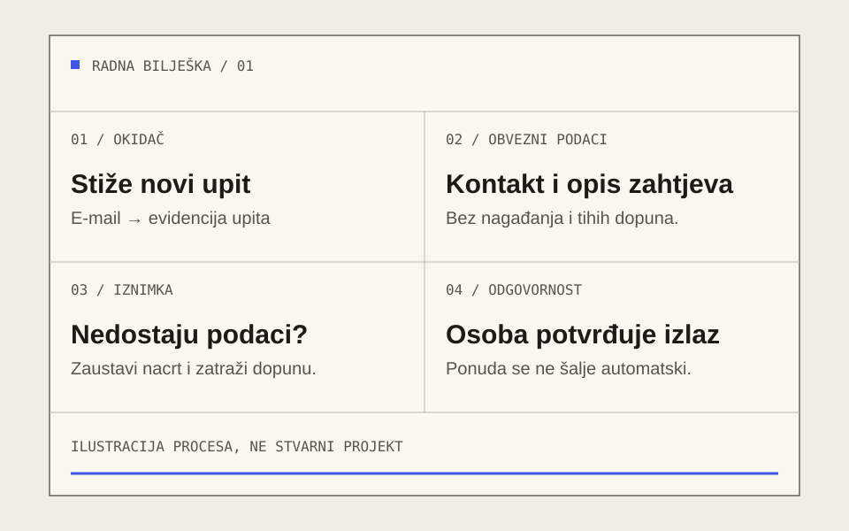
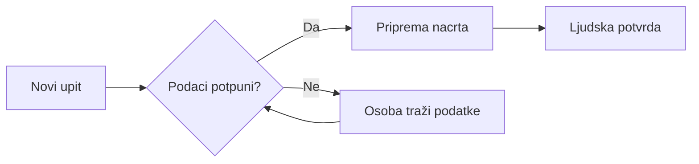

<!-- Input specimen only; YAML is guidance for an agent, not parsed by the site.
     The live page adds its own H1, byline, dates, TOC, and example notice.
     Primary reader question: Koji poslovni proces prvo automatizirati?
     The agent turns the data table below into the accessible static chart too. -->

Najbolji prvi kandidat za automatizaciju poslovanja obično nije najveći problem u tvrtki. To je mali proces koji se često ponavlja, ima razumljiva pravila i ostavlja dovoljno prostora da osoba provjeri rezultat.

Zamislite da svaki novi upit kupca prepisujete iz e-maila u tablicu, tražite nedostajuće podatke i ručno pripremate ponudu. Svaki pojedini korak izgleda kratko. Zajedno prekidaju posao više puta dnevno. Prije odabira alata vrijedi odgovoriti na jednostavnije pitanje: **što se točno ponavlja, a gdje je Vaša procjena nezamjenjiva?**

> [!summary] Ukratko
> - Počnite od jednog procesa s jasnim početkom i krajem.
> - Izmjerite ručni rad prije nego što obećate uštedu.
> - Odvojite ponovljive korake od odluka koje treba donijeti osoba.
> - Testirajte na malom uzorku i dokumentirajte iznimke.

## 1. Prepoznajte dobar prvi proces

Dobar kandidat možete objasniti kolegi bez otvaranja pet različitih aplikacija. Znate što pokreće proces, koji podaci moraju biti prisutni i kako izgleda dovršen posao. Ako taj opis još ne postoji, njegovo pisanje često je korisniji prvi korak od programiranja.

### Tri pitanja za početak

1. **Koliko često se posao ponavlja?** Zabilježite stvaran broj slučajeva tijekom uobičajenog tjedna, ne samo tijekom najprometnijeg dana.
2. **Možete li pravila zapisati?** „Ako nedostaje e-mail, zaustavi pripremu” provjerljivo je pravilo. „Prepoznaj dobrog kupca” nije dovoljno precizno.
3. **Možete li prepoznati pogrešku?** Ako rezultat nije lako provjeriti, prvo osmislite provjeru i siguran način povratka na ručni rad.

Nemojte birati samo prema količini posla. Pogrešno poslana ponuda ili nenamjerno podijeljeni osobni podaci mogu koštati više od vremena koje ste uštedjeli. Poslove s većim posljedicama treba razdvojiti u manje korake i uvesti dodatnu kontrolu.

> Ne automatizirajte nejasnoću. Prvo razjasnite proces, a zatim ubrzajte ono što se ponavlja.
>
> — Radno načelo u ovom ilustrativnom primjeru



*Ilustrativna radna bilješka. Četiri jasna odgovora prije odabira alata; nije dokumentacija stvarnog klijenta.*

## 2. Usporedite pristupe

Nije svaki problem razlog za novu aplikaciju. Ponekad je dovoljno urediti obrazac, dodati predložak ili povezati dva postojeća alata. Usporedite najjednostavniji mogući zahvat s posljedicama njegova održavanja.

**Primjer odluke: kako obrađivati upite kupaca**

| Pristup | Kada ima smisla | Na što paziti |
| --- | --- | --- |
| Urediti postojeći proces | Malo upita, ali nejasni podaci i odgovornosti. | Dogovor mora biti jednostavan i stvarno korišten. |
| Povezati postojeće alate | Koraci i pravila već su stabilni. | Prava pristupa, prekidi integracije i ograničenja alata. |
| Izraditi prilagođeno rješenje | Posebna pravila ili iznimke koje postojeći alati ne pokrivaju. | Održavanje, dokumentacija i predaja znanja. |

U ovom zamišljenom slučaju prvo bismo standardizirali ulazne podatke. Tek nakon toga ima smisla automatski pripremati nacrt ponude. Time ne preskačemo važan posao; smanjujemo broj pretpostavki koje bi budući sustav morao pogađati.

## 3. Izmjerite polazište

Mjerite vrijeme aktivnog rada, odvojeno od čekanja kupca ili kolege. Zapišite koliko je upita bilo potpuno, koliko ih je trebalo dopuniti i koliko je rezultata naknadno ispravljeno. Prosjek bez tih podataka lako daje pogrešnu sliku.

Graf prikazuje **izmišljenu usporedbu**: 18 minuta ručnog rada nasuprot 7 minuta uz podršku alata, po jednom upitu. To je demonstracija prikaza podataka, ne prognoza rezultata automatizacije.[^podaci]

**Izmišljeno vrijeme aktivnog rada po upitu, u minutama**

| Korak | Ručno | Uz podršku alata |
| --- | ---: | ---: |
| Provjera podataka | 5 | 2 |
| Priprema nacrta | 9 | 3 |
| Evidencija i potvrda | 4 | 2 |
| **Ukupno** | **18** | **7** |

*Slika 2. Ilustrativni prikaz, ne obećanje uštede. Osoba i dalje provjerava nacrt prije slanja.*

Za zamišljenih 40 upita tjedno: `(18 − 7) × 40 = 440` minuta razlike. Trošak izrade, održavanja i dodatnih provjera nije uključen. To nije izračun povrata ulaganja.

> [!important] Važno ograničenje
> Brži postupak nije bolji ako stvara više ispravaka. Uz vrijeme pratite točnost, broj iznimki i može li druga osoba razumjeti što se dogodilo.

## 4. Zadržite čovjeka u procesu

Dobar tijek rada mora objasniti i što se događa kad nešto nedostaje. Ako je upit nepotpun, sustav ga ne bi trebao tiho odbaciti niti nadopuniti nagađanjem. Označi iznimku, sačuva ulazne podatke i preda odluku osobi.



*Slika 3. Primjer procesa s vidljivom iznimkom, povratnom vezom i ljudskom potvrdom. Automatizacija ne znači slanje ponude bez odobrenja.*

### Što treba ostati vidljivo

- **Ulaz:** odakle je upit stigao i koji su podaci zaprimljeni.
- **Pravilo:** zašto je sustav odabrao određeni korak.
- **Iznimka:** što nedostaje i tko je odgovoran za nastavak.
- **Potvrda:** tko je odobrio izlaz i kada.

Ako koristite AI za tumačenje slobodnog teksta, provjerite rizike pogrešnog izlaza i način zaštite podataka. Okvir NIST AI RMF može poslužiti kao polazište za razmišljanje o rizicima, ali ne zamjenjuje procjenu konkretnog procesa.[^nist]

## 5. Dokumentirajte pravila

Pravila opišite običnim jezikom prije nego što ih pretvorite u kod. „Nacrt se priprema samo kada postoje kontakt i opis zahtjeva” korisna je rečenica i za vlasnika procesa i za budućeg održavatelja.

**Primjer pravila / pseudokod**

```go
// Ilustrativno pravilo, ne gotova integracija.
if upit.Email == "" || upit.Opis == "" {
    return "ljudska-provjera"
}
return "pripremi-nacrt"
```

Ovaj kratki primjer provjerava samo jesu li polja prazna. Pravo rješenje traži i provjeru formata, ovlasti, obrade pogrešaka i ponašanja kod ponovljenog upita. Za sigurnosnu provjeru web-rješenja koristan početni pregled daje [OWASP Top 10](https://owasp.org/www-project-top-ten/).

Na kraju pripremite kratke upute: gdje se proces zaustavlja, kako ponoviti korak, kome prijaviti problem i kako privremeno nastaviti ručno. To je dio rješenja, ne dodatak koji se piše samo ako ostane vremena.

## Prvi korak: mali, provjerljiv test

Ne morate odmah odlučiti o novoj aplikaciji. Odaberite jedan proces, zapišite njegovo današnje ponašanje i odredite što bi mali test trebao dokazati. Dobar prvi test može pokazati i da se dio posla *ne isplati* automatizirati.

- [ ] Imamo jasan početak, kraj i odgovornu osobu.
- [ ] Imamo zabilježeno polazište i način usporedbe.
- [ ] Znamo koje podatke smijemo koristiti.
- [ ] Imamo dogovorenu provjeru i obradu iznimki.
- [ ] Možemo se vratiti na ručni postupak.

Ako Vam treba druga perspektiva, [pogledajte moj način rada](https://eriksoftware.hr/#kako-radim). Krećem od razumijevanja potrebe i idejnog rješenja, a ne od prodaje unaprijed odabranog alata.

## Česta pitanja

### Treba li za automatizaciju odmah koristiti AI?

Ne. Ako su podaci strukturirani, a pravila jasna, obična integracija ili mali program mogu biti jednostavnije rješenje. AI ima smisla razmotriti kada je potrebno tumačiti nestrukturirani sadržaj, uz provjeru rezultata i rizika.

### Može li se krenuti bez promjene postojećih alata?

Ponekad može. Najprije provjerite nude li alati siguran način povezivanja i smijete li pristupati potrebnim podacima. Ako ne nude, ne treba obećavati integraciju prije tehničke provjere.

### Kako ću znati je li mali test uspio?

Dogovorite kriterije unaprijed: manje aktivnog ručnog rada, prihvatljiva točnost, razumljive iznimke i mogućnost nastavka bez ovisnosti o jednoj osobi. Vrijeme je samo jedan dio procjene.

## Izvori i bilješke

[^podaci]: Svi brojevi u tekstu, grafu i tablici izmišljeni su za demonstraciju formata. U stvarnom članku navedite izvor, razdoblje mjerenja, uzorak i ograničenja.
[^nist]: [NIST — AI Risk Management Framework](https://www.nist.gov/itl/ai-risk-management-framework). Polazište za razumijevanje i upravljanje rizicima primjene AI-a, ne izvor ilustrativnih brojki.

- [OWASP Top 10](https://owasp.org/www-project-top-ten/). Pregled važnih rizika sigurnosti web-aplikacija; nije potpuna sigurnosna provjera.
